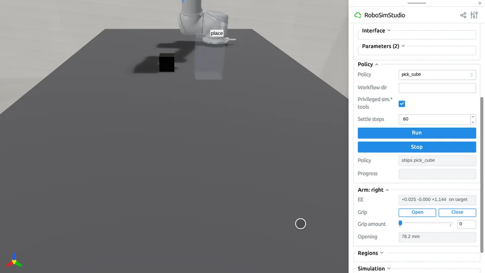

# A real UR5 cell

A CB3 UR5 with an ATI Axia80-M8, a wrist RealSense D415 and a Robotiq 2F-85,
picking a 60 mm black cube: its twin here, and one graph that runs on both.

<!-- examples:start: written by scripts/example_readmes.py from each script's docstring -->

## UR5 cell: pick and place, in the twin



The real cell's CB3 UR5, Axia80, wrist D415 and 2F-85 pick a 60 mm black cube
and set it down on the place spot, scored as the benchmark scores it.

`pick_cube/` sees through the wrist camera alone (`privileged=False`: no
`sim.*` tool), and every pose it asks for reaches the arm as one `moveJ` at
the speed the real arm is driven at (`twin.MoveJFacade`). So a pass here has
been tried on the commands `run_real.py` sends the hardware. The
cell's numbers -- the hand-eye calibration, the camera's intrinsics, the gripper
mount, the table under the base -- are in `cell.py` with where each was
measured. Needs the `[gap]` extra.

```bash
uv run --extra gap examples/10_ur5_cell/00_sim_pick_place.py
```

Source: [`00_sim_pick_place.py`](00_sim_pick_place.py)

<!-- examples:end -->

## What is here

| File | What |
| --- | --- |
| `cell.py` | The cell, measured: the table, the robot (`ur5_cb3_cell`), the wrist camera rig (`ur5_wrist@v1`), the cube and the task. Every number says where it was measured. |
| `assets/` | The UR5's MJCF: the CB3's DH chain (its flange is UR's `tool0` to 0.0 mm), the published link masses, the tool stack as primitives. UR5 meshes from ros-industrial, BSD. |
| `pick_cube/` | The graph: look, find the cube in one wrist RGB-D frame, pick across two faces, check the jaws stopped on it, set it down. No `sim.*` tool. |
| `twin.py` | `MoveJFacade`: every pose the graph asks for reaches the arm as one `moveJ`, at a capped joint speed, inside the real joint box. `CellGraph` runs a graph through it. |
| `real.py` | `RealFacade`: the same, onto the hardware, through ur5-VLA's drivers. |
| `run_real.py` | The graph on the real arm; a dry run unless `--execute`. Not a numbered example: it needs the cell, so no take can film it. |

## Frames

The work-surface origin is the table under the middle of ur5-VLA's cube search
patch: `(0.525, -0.20, -0.0173)` m in the UR `base` frame, with the same axes.
A pendant reading `(x, y, z)` is `(x - 0.525, y + 0.20, z + 0.0173)` here
(`cell.base_to_work`). The twin's world is the work frame raised by the table's
0.75 m.

## What the measurements are

| Fact | Value | From |
| --- | --- | --- |
| Arm kinematics | CB3 UR5 DH | checked against ur5-VLA's `fk` over random postures: 0.0 mm |
| Gripper mount | 81.55 mm along the flange, half a turn | ur5-workspace's tool CAD; pinch point 237.4 mm vs 233.9 mm measured |
| Wrist camera | hand-eye `T_flange_cam` | ur5-VLA `configs/calibration/wrist_handeye.yaml`, 52 views, 1.5 mm rms |
| D415 intrinsics | fx 607.30, fy 607.15, cx 324.58, cy 233.71 | read off the device (serial 234422064578) |
| Table height | -0.0173 m in `base` | `locate.py` on 40 recorded wrist frames: 3.3 mm under ur5-VLA's -0.014 |
| Joint box | `engineered.yaml` `safety.joint_*_deg` | where ur5-VLA's cube skill was proven, cables included |
| Held cube | gripper 0.337 closed (0.66 open) | 60 recorded scripted picks |
| Contact stop | 25 N on the Axia80 | a scripted pick peaks at 11 to 13 N; an empty hand stays under 2.5 N |

## Perception on real frames

`pick_cube/scripts/locate.py`, unchanged, on the first wrist frame of 79
scripted-collection episodes (`/data/ur5VLA-data/20261113-{125019,142018}_collect_loop_s10{1,2}`),
posed by the logged joints and the hand-eye solve, against where the previous
episode set the cube down: all 79 found, from depth; position error median
3.7 and 4.1 mm, worst 10.4 mm; yaw within 15 degrees, which the jaws square up
on closing.

## Running it

The twin, from the repository root:

```bash
uv run --extra gap examples/10_ur5_cell/00_sim_pick_place.py --at -0.04 -0.06 --yaw 30
```

The real arm needs ur5-VLA's checkout (beside this repository by default,
`--ur5vla` otherwise) and its device libraries:

```bash
uv run --extra gap --with ur_rtde==1.6.5 --with pyrealsense2==2.59.1.11053 \
  --with minimalmodbus --with pyserial --with pyyaml \
  examples/10_ur5_cell/run_real.py                    # dry run: nothing moves
# ... --execute                                           # asks before every moveJ
# ... --execute --yes                                     # asks once
```

Before the real run:

1. Arm powered, brakes released, no External Control program running.
2. The 2F-85 on its USB/RS-485 adapter with 24 V, not wired through the tool
   connector; Axia80Monitor closed.
3. The cube inside the search patch and nothing else near it.
4. Start from ur5-VLA's `cube_look` pose. A dry run moves only the twin, so its
   camera looks from wherever the arm is, and `locate.py` refuses a frame whose
   most common height is not the table.
5. Run the dry run first, and read every `[dry run] would moveJ` line. In a dry
   run the twin's hand closes on air, so it ends at the grip check: expected.
6. Keep the pendant's stop in reach.

What stops a real motion: ur5-VLA's `SafetyLayer` before it (the joint box, the
workspace box swept along the `moveJ`, the robot's state); during it, a
protective or emergency stop, or more than 25 N on the Axia80, which issues a
`stopJ` and fails the node; and a refused confirmation.
